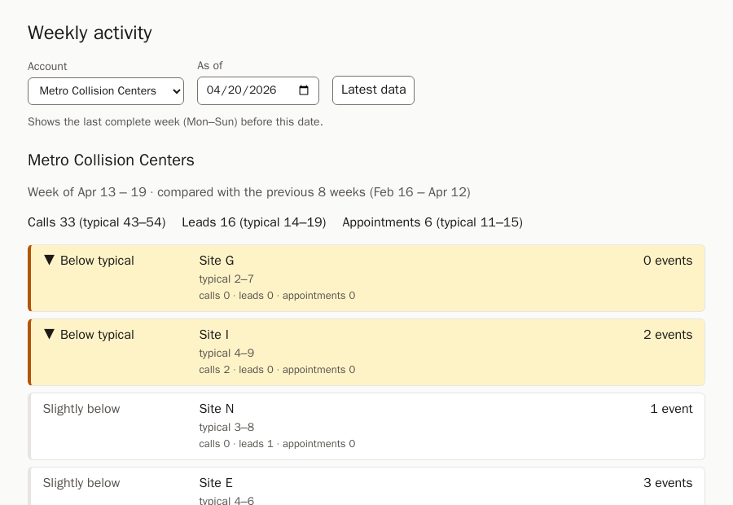
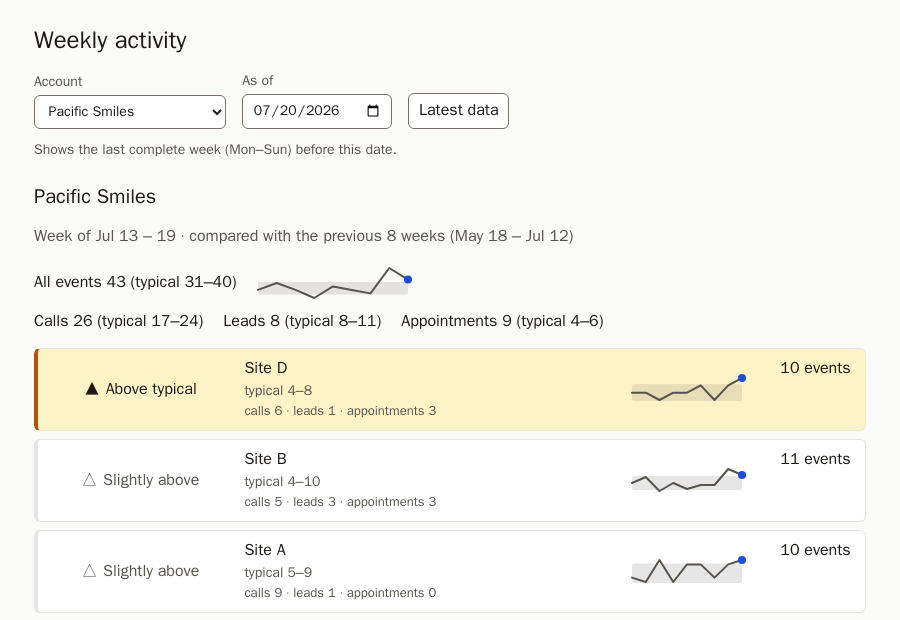

# Relay — "Is this normal for us?"

Each location's last complete week, compared with its own previous 8 weeks, so a customer admin can see on Monday morning which sites need attention. Full reasoning, decisions D1–D15 and their alternatives are in [PLAN.md](PLAN.md); this README is the short version.

## Running it

**You need:** Docker with Compose v2 (`docker compose version`), git, and `make`. Without `make`, run the command shown next to each target in the `Makefile`. Ports 5432, 8000 and 5173 must be free, or set `DB_PORT`, `BACKEND_PORT` and `FRONTEND_PORT`.

```bash
git clone <this repo> && cd <repo folder>
docker compose up --build
```

The first run pulls the base images (Postgres, Python, Node and nginx, about 550 MB) and builds the app, so it takes a few extra minutes. Later starts take seconds. When the frontend logs `Configuration complete; ready for start up` (a few seconds after the backend's `Uvicorn running`), open **<http://localhost:5173>**. On first start the backend creates the schema with migrations and loads `data/seed.sql` once. The API's interactive docs are at <http://localhost:8000/docs>. Stop with `Ctrl+C`, or `docker compose down` (add `-v` to delete the database).

**Tests:** `make test` (backend: rules, aggregation, seed known answers, API) and `make test-frontend` (UI). Both run in Docker against throwaway databases, with nothing installed locally.

## Try these

The account and as-of date live in the URL, so these links (and a reload) open exactly this view:

- [`/?account=6&as_of=2026-04-20`](http://localhost:5173/?account=6&as_of=2026-04-20): the **Site G outage**. 0 events against typical 2–7 tops the list, ahead of Site I. The whole account was low too (calls 33 vs typical 43–54).
- [`/?account=15`](http://localhost:5173/?account=15): the **latest week**. Site C is above typical (12 vs 4–7) and Site B below (2 vs 4–12).
- [`/?account=5&as_of=2026-07-20`](http://localhost:5173/?account=5&as_of=2026-07-20): **Pacific Smiles**. Site D is flagged at 10 events (typical 4–8), while Site B at 11 is only "slightly above" (typical 4–10). Each location is judged against its own range, not by raw size.
- [`/?account=20`](http://localhost:5173/?account=20): an **account with no activity**.

 

All four screenshots are in `assets/screenshots/`. To regenerate them, run `make screenshots` against a running stack; it uses Playwright's Docker image, about 2.4 GB.

## The ticket

> **DASH-247 — Help customers understand whether their recent activity is normal**
>
> Customers looking at their dashboard can't tell whether this week's numbers are good, bad, or typical for them. Product wants the dashboard to help a customer answer *"is this normal for us?"* at a glance, without exporting data or calling their account manager.
>
> **Notes from product:**
>
> - probably involves comparing against some baseline
> - multi-location customers matter
> - a customer admin should be able to look at this Monday morning and act on it
>
> **Out of scope per product:** alerting/notifications, ML/forecasting.

## How I read it

- **"Normal for us" means normal for this location**, compared with its own recent history, not with peers. Sites within one account differ too much in size for site-vs-site comparison to mean anything.
- **"This week" on a Monday morning means the last complete Mon–Sun week**, in the account's own timezone.
- **Multi-location is the core case:** one list per account, with the locations that need attention first.
- **The answer has to fit one line an admin can trust:** "Site B: 2 events, typical 4–12". With ML out of scope, the rule must be explainable.

## Key decisions and trade-offs

Full list with alternatives: [PLAN.md §2](PLAN.md). Thresholds live in `backend/relay/thresholds.py`.

| Decision | What it buys | What it costs |
|---|---|---|
| Baseline = **median of the previous 8 weeks**; typical range = **middle 6 of those 8** (D3, D4) | A one-off spike (account 6 logged 880 events in a week; its median week is 76) doesn't distort the baseline or the range | Only 8 weeks, so no seasonality; slower to notice a gradual trend |
| **Status on the location total**, with per-type counts as context only (D5) | Enough volume to say anything; split by type, 91% of location × type combinations are too small | Calls, leads and appointments are summed into one number |
| **Minimum volume applies to the baseline median** (≥ 5/week), not to this week (D6) | A drop to zero gets flagged, which is the most important Monday signal | Very small sites always read "too little activity to tell" |
| **Flag only when clearly outside the range**: at least 30% of a normal week beyond the edge (D13) | 3 flagged locations instead of 18 at the latest week (7–9 in the April weeks checked); one stray event never flags | Near misses show only as "slightly below/above" |
| **One global as-of date**; weeks bucketed in each account's IANA timezone (D1, D2) | A location that went quiet can't silently fall back to an older week; daylight-saving switches are handled | Default as-of edge case, see "Known limitations" |
| **Exact duplicates removed at query time**, near-duplicates kept (D9) | The seed stays as-is; near-duplicates differ in outcome or duration, so they look like real separate events | Any fuzzy duplicates in production would still be counted |

**Why the typical ranges look wide:** locations are small. A typical location sees about 6–7 events a week, and at that size ordinary weeks swing a lot: at locations averaging 5–7 events a week, 43% of weeks land more than 30% from the location's own median, and 1 in 5 more than 50%. The typical range (usually about 0.7× to 1.4× the median) shows that noise instead of hiding it. That's why a week has to be clearly outside the range before it's flagged.

## Stack and why

- **Postgres:** `AT TIME ZONE` handles IANA zones and daylight saving natively, and local-time bucketing is the riskiest correctness area.
- **FastAPI + Pydantic:** the response models are the API contract. **SQLAlchemy 2.0 (sync) + Alembic** handle the connection layer and migrations.
- **React + TypeScript (strict) + Vite:** served by nginx, which also proxies `/api`, so there's no CORS setup.
- **Docker Compose:** one command for Postgres, backend and frontend; tests run in containers too.

Notable choices inside it:

- **Raw SQL for the aggregation, Alembic's schema operations for the schema.** The weekly aggregation (removing duplicates, local-time conversion, `generate_series` to fill empty weeks) is one readable query with bound parameters in `relay/weekly.py`. An ORM would hide the part that most needs to be visible. The schema, indexes and the duplicate-free view `activity_events_dedup` are Alembic migrations.
- **SQL buckets the data; pure Python applies the rule.** `relay/normality.py` has no database access and uses exact `Fraction` arithmetic, so a distance of exactly 0.3 is flagged.
- **The URL is the only UI state.** Reload, share and back/forward all work, and there's no second copy of the state to drift. **The frontend renders and never ranks:** the API returns locations already ordered, with an explicit `flagged` field.

## How the numbers were verified

- **An independent reference calculation.** `analysis/reference.py` recomputes everything with SQLite and Python's `zoneinfo`, sharing no code with the app. The seed known-answer tests (status counts at four dates, full ranked lists, account totals) use its output, never the app's own. Synthetic tests show their arithmetic in comments.
- **Failing tests committed before the code** in every phase; `git log` shows each "Add failing tests…" commit ahead of its implementation.
- **Injected bugs:** 19 deliberate bugs across the phases (for example the flag boundary `>=` changed to `>`, a UTC date instead of the local date, no zero-fill, the UI re-sorting rows). Each one made at least one test fail before it was reverted.
- **A fresh-clone install, following this README.** It found two bugs, both fixed: the UI wasn't ready yet at the startup log line the README pointed to, and the test runs left root-owned files in the checkout.

## Deliberately deferred

- **Missed-call rate:** time went to tests instead. It also needs a minimum number of calls, and per location probably a 4-week window, since a location gets about 4 calls a week.
- **Alerting, notifications, ML/forecasting:** out of scope per product. **An LLM in the feature:** the answer is already a deterministic line that admins need to trust; see [PLAN.md §10](PLAN.md).
- **Account-level flags, configurable weeks or a rolling window, editable thresholds:** each needs a product decision first. **Auth and tenant isolation, peer benchmarks, fuzzy duplicate matching:** not needed to answer the ticket.

## With another day

1. Tune `MIN_FLAG_DISTANCE` and `MIN_BASELINE_MEDIAN` with product, using the examples below and in "Try these".
2. Add the missed-call rate per account, with a minimum number of calls.
3. Make the default as-of the last week that has ended in every account's timezone, and show how fresh the data is (fixes the limitation below).
4. Add a 9-week sparkline per location.
5. Set up CI that runs `docker compose up` from scratch, both test suites, and one browser smoke test.

## Known limitations and open questions

- **Account totals** (not defined in PLAN.md) are the account's own weekly counts per event type. Every event counts, including a new location's partial first week, so this week's total still equals the sum of the rows. They use the same median and range rule. They're context only and never flagged, even when well outside their range: Pacific Smiles appointments were 9 vs typical 4–6 in the week of Jul 13.
- **The default as-of is the UTC date of the latest event (D2).** If data arrives up to a Sunday evening in a US timezone, the UTC date is already Monday, so the default picks a week that hasn't ended locally and can falsely flag it below typical. The seed isn't affected. Switching to today's date doesn't fix this if "today" is the UTC date: it has the same flaw. The default must pick the last week that has ended in every account's timezone (for example, using today's date in the westernmost zone).
- **Questions for product:** see [PLAN.md §3](PLAN.md). Two more came up in review:
  - **The 0.3 threshold sits close to cases a person would call worrying.** Account 6 Site N, week of Apr 13: 1 event vs typical 3–8, distance 2/7 ≈ 0.29, so only "slightly below".
  - **Above and below typical share one highlight on purpose.** Whether more activity is good depends on the business.

Where things live in the code: see "Where things live" in [CLAUDE.md](CLAUDE.md).
